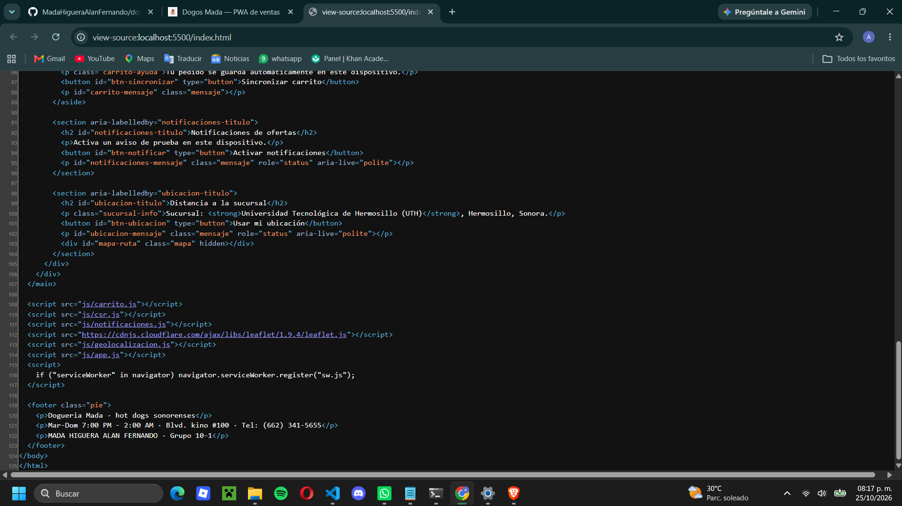
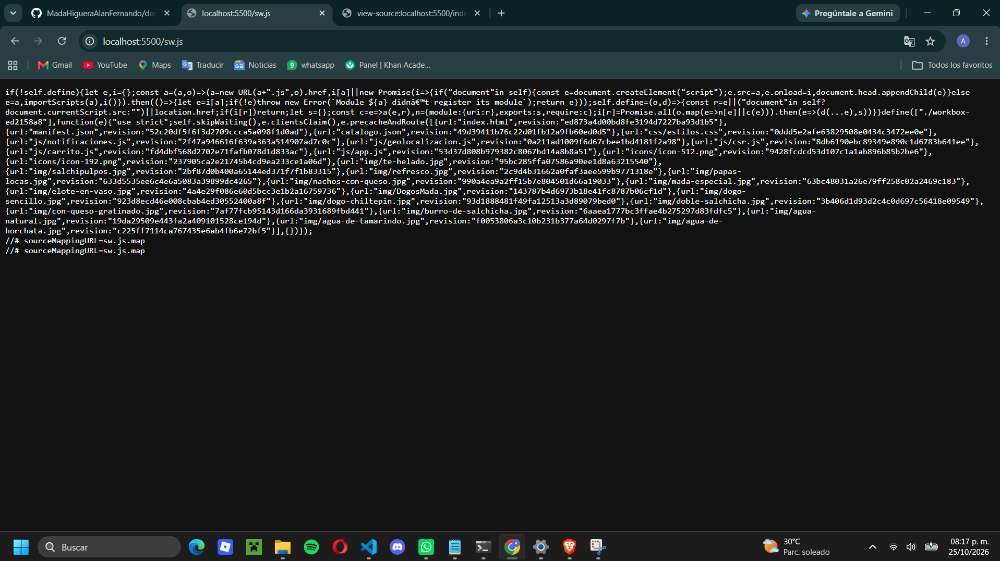

# Dogos Mada — PWA de ventas

| Dato | Valor |
|---|---|
| **Alumno** | MADA HIGUERA ALAN FERNANDO |
| **Grupo** | ING10-1 |
| **Negocio · giro** | Dogos Mada · hot dogs sonorenses |
| **URL del repositorio** | https://github.com/MadaHigueraAlanFernando/dogos-mada-pwa_mada-higuera-alan-fernando.git|
| **URL de GitHub Pages** |  https://madahigueraalanfernando.github.io/dogos-mada-pwa_mada-higuera-alan-fernando/ |

## Historial de avances

| Avance | Hash del commit entregado | Fecha |
|---|---|---|
| 1 | (78e309383951a55b9333ebf9ee930c943f4026fb) | 11/10/2026 |
| 2 | (fe71cd331a261218f5d94546af2dc55a6b1fb2fd) | 18/10/2026 |
| 3 | (d37af873ebdaa8d92cfec9b113525e410669963b) | 25/10/2026 |
| 4 | (se escribe en el reporte PDF) | 01/11/2026|

## Comparación SSR vs CSR

### SSR (Django): los productos llegan escritos en el HTML

### CSR (JavaScript): el div del catálogo llega vacío

## Funciones PWA (avance 3)

### index.html: manifest y registro del Service Worker activos

### sw.js: Workbox precachea el catálogo y las fotos

## Auditoría Lighthouse (avance 4)

Auditoría hecha sobre la URL publicada en GitHub Pages con `npx lighthouse`.

| Reporte | Performance | Accesibilidad | Buenas prácticas | SEO |
|---|---|---|---|---|
| [Móvil](docs/lighthouse-movil.html) | 95 | 100 | 100 | 100 |
| [Escritorio](docs/lighthouse-escritorio.html) | 98 | 100 | 100 | 100 |
